# Cribrum

Website: https://cribrum.bertons.me

*Cribrum* is Latin for "sieve" (Italian: *crivello*).

Cribrum finds photos and videos on your phone that you can delete or recompress without losing memories that matter: blurry shots, duplicate copies, bursts, takes of one moment, short clips recorded by mistake, photos of lecture slides and notes, screenshots, and media scattered by messaging apps.

It suggests and you decide. Nothing is deleted without your confirmation. The button under each page moves the marked files to a trash folder on the phone, where you can restore them until the retention ends.

## What it does

Cribrum is an Android app that inspects device storage, including folders marked with `.nomedia` that gallery apps skip, such as `WhatsApp Video/Sent`. It groups candidates into categories for review, recompresses large camera JPEGs, and draws a storage map.

The detectors are tuned on one person's library, so expect some wrong suggestions and some misses. Cloud libraries such as Google Photos, iOS and desktop are not covered.

## Features

### Categories and cleanup

The Photos tab of Clean lists the space you can free in nine categories:

- **Exact copies.** Identical files, matched with xxHash3-64.
- **Similar copies.** Recompressed, resized or edited copies, found with 64-bit DCT perceptual hashes (pHash) and MobileCLIP embeddings.
- **Bursts.** Photos taken at most three seconds apart.
- **Blurry.** Low Laplacian sharpness on the subject, so intentional portrait blur is not flagged.
- **Too dark or too bright.** Pocket shots, black frames and blown-out images, from luminance histograms.
- **Screenshots.** Directory, display dimensions and missing camera metadata.
- **Documents and notes.** Slides, whiteboards, handwriting, receipts and printed pages, from PP-OCRv4 text coverage and zero-shot classification.
- **Forwarded.** Memes and greeting images in messaging folders that lack camera metadata.
- **WhatsApp stickers.** Files in messaging apps' sticker folders.

A category opens into a grid with the suggested deletions already marked. A tap flips a mark, a long press opens the image at full size with the reasons it was flagged, and a menu sorts by day, week, month or size. The button under the grid moves the marked images to the trash and shows an Undo snackbar.

### Duplicate and burst groups

Exact copies, similar copies and bursts open as groups. The app picks the best copy to keep, such as the highest resolution or the sharpest shot, and shows it beside the others. You compare them side by side and change which copy stays.

### Videos

The Videos tab of Clean has its own scan button ("Scan videos"), its own counts and its own total. Its first row, "Largest videos", lists every video you have not reviewed, biggest first. Below it are the categories that have a video detector:

- **Exact copies.** Same size and content hash.
- **Similar copies.** Videos of nearly the same length (within 100 ms) whose five MobileCLIP frame embeddings match. It finds the re-encoded copy WhatsApp keeps in `Sent` and keeps the camera original.
- **Blurry** and **Too dark or too bright.** The median over the five frames, with thresholds of their own.
- **Forwarded.** Every video in a messaging app's folder, `Sent` included.
- **Takes of one moment.** Camera videos that start within five minutes of the previous one's end, split where the frames differ. There is no best take, so nothing is preselected.
- **Short clips.** Clips under 15 seconds, scored higher when a camera photo was taken beside them, they are a failed take, they are dark or blurred, or they are silent clips in a chat folder.

A tile shows a frame, the length and the size. In Short clips the first tiles on screen loop muted, so you can decide at a glance. Holding a tile opens the video in the app (Media3 ExoPlayer), with a strip of five frames to jump to. In a video category a video's score is multiplied by its size, so large videos come first.

### Photo compression

The Compress tab recompresses large camera JPEGs instead of deleting them. It lists photos only, largest first, and preselects none. Video compression is not built.

- **Three levels.** High quality is JPEG 90 at full resolution. Balanced is JPEG 85 and scales photos above 50 MP down to 50 MP. Smallest is JPEG 80 and scales photos above 12 MP down to 12 MP. Balanced saved a median 47% on one phone's camera photos in the lab.
- **Split comparison.** A slider compares the original with the real recompressed result before you confirm, and zooms down to single pixels.
- **Metadata.** The copy keeps the standard EXIF tags (date taken, camera and lens, orientation), GPS and, on Android 14 and newer, the Ultra HDR gain map. It loses the original XMP (except the new gain map's), the Samsung SEF trailer, C2PA credentials, IPTC, the EXIF thumbnail and the shooting mode info, and maker notes are not guaranteed. The summary says so before you confirm.
- **Reversible.** The original goes to the trash, and one button undoes the whole batch.
- **Background batches.** A batch runs with a notification and pauses while the phone is severely hot.

### Trash and undo

- **Where.** A `.cribrum-trash` folder at the root of each storage volume, with a `.nomedia` file. Moving is a rename on the same volume, never a copy, and the folder survives an uninstall.
- **Retention.** 30 days by default, or 7, 14, 60 or 90 days in Settings. The scan purges expired files. Files are deleted for good only when the retention ends, when you delete them from the trash, or when you tap "Free X now". The last two ask first.
- **Restore.** A file goes back to its original path, and is not restored over another file.
- **Freeing space now.** After a page that trashes more than 1 GB, the snackbar offers "Free 2.3 GB now". It asks first, then deletes only the files of that page.

### Favourites and protection

- **Gallery favourites.** Photos and videos you hearted in the gallery show a heart and start unticked. You can heart or unheart one from the full-size view.
- **Confirmation.** A page that marks a favourite for the trash asks first.
- **Recall over precision.** Protections never hide a candidate. They only move it down the order.

### Background scans

"Scan now" scans photos and "Scan videos" scans videos. Either runs as a foreground service with a stop button. Cribrum also scans once a night at 02:00 while the phone charges (it only runs between 00:00 and 06:00, otherwise it waits for the next night).

- **Photos.** The normal scan finds and records videos but never opens them, so you do not pay for the video steps.
- **Videos.** The night scan analyses new videos only after you ran "Scan videos" once.
- **Two switches.** Settings has "Analyse images at night" and "Analyse videos at night", both on by default. With both off, the night run only empties the expired trash.
- **Heat.** The scan shows a line when the phone is hot enough to slow it down, and does not pause for it. Compression batches do pause.

### Settings and storage map

- **Trash retention**, **Haptics**, and **Language** on Android 13 and newer.
- **Detection thresholds.** A slider for each category except Exact copies, WhatsApp stickers and Takes of one moment, with live candidate counts. Blurry and Too dark or too bright have a second slider for videos, and Short clips has one for videos only.
- **Excluded folders.** Folders and their subfolders left out of the review and the map.
- **Storage map.** A treemap of the photo and video space per folder. Tap a block for its size, file count and video share, open it, or exclude the folder.
- **Scan report.** The last scan, the steps that have not covered every file and what the app takes on the phone.

## Screenshots

<table>
  <tr>
    <td>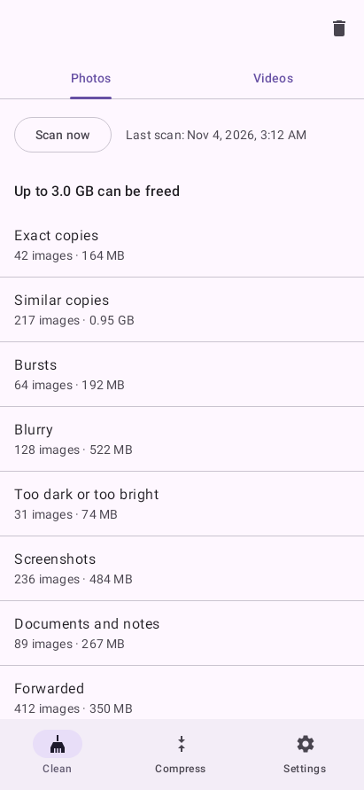</td>
    <td>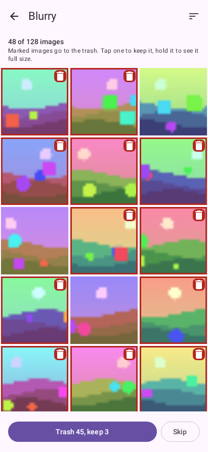</td>
    <td>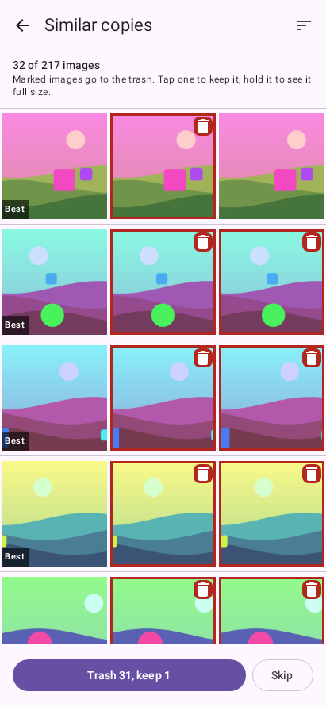</td>
  </tr>
  <tr>
    <td>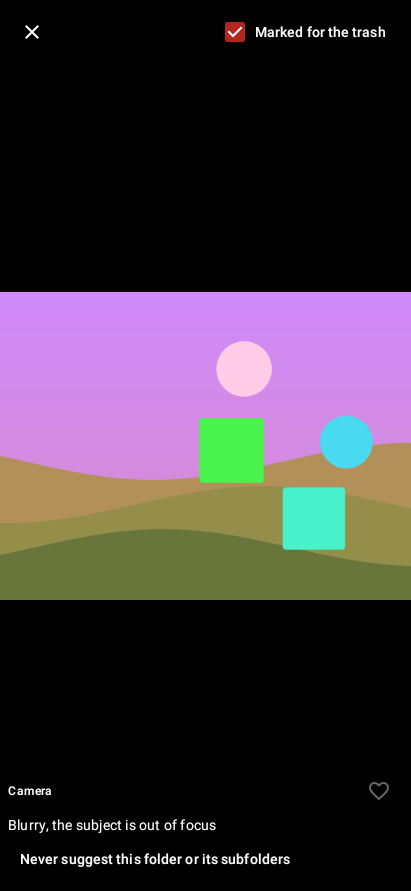</td>
    <td>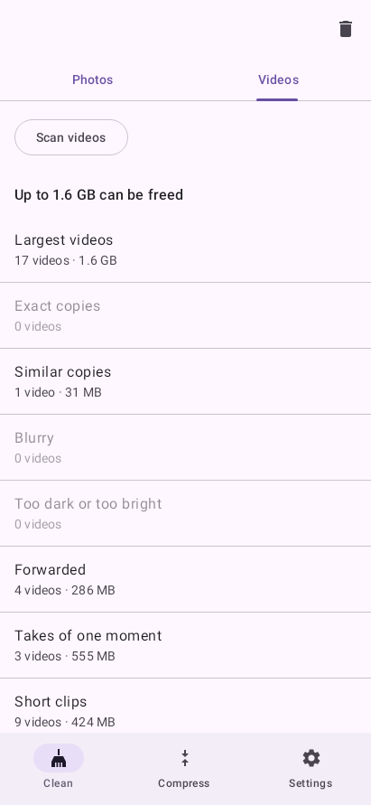</td>
    <td>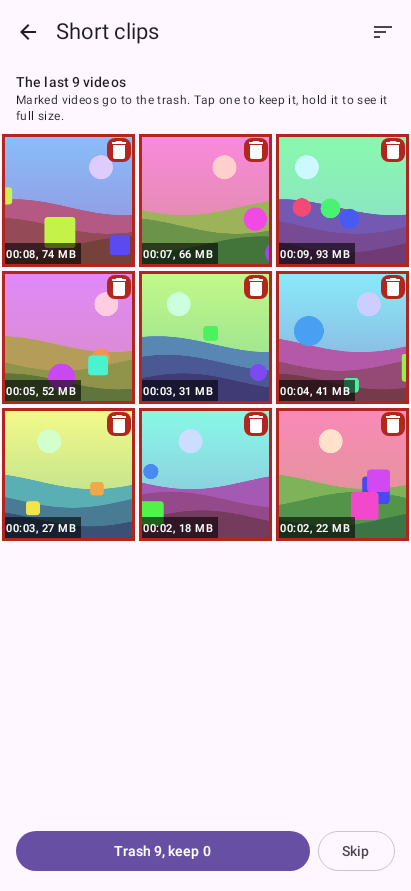</td>
  </tr>
  <tr>
    <td>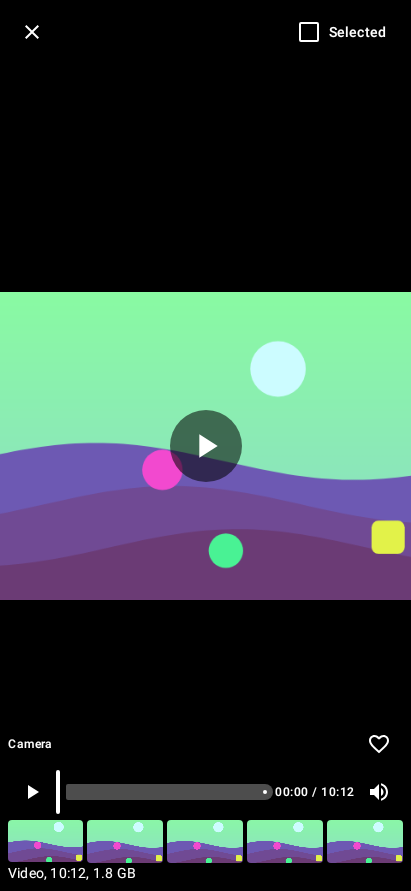</td>
    <td>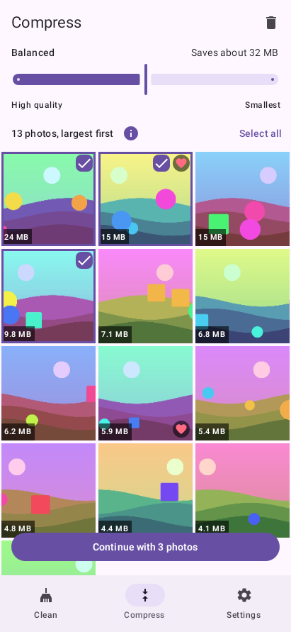</td>
    <td>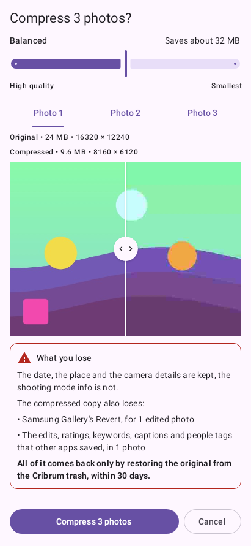</td>
  </tr>
  <tr>
    <td>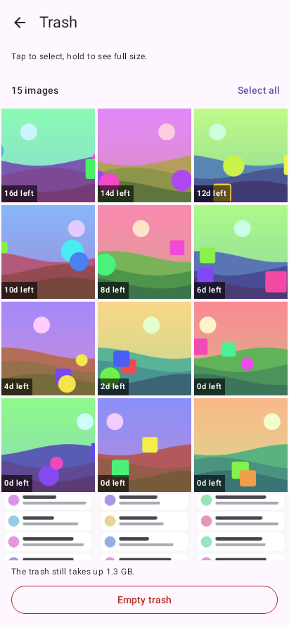</td>
    <td>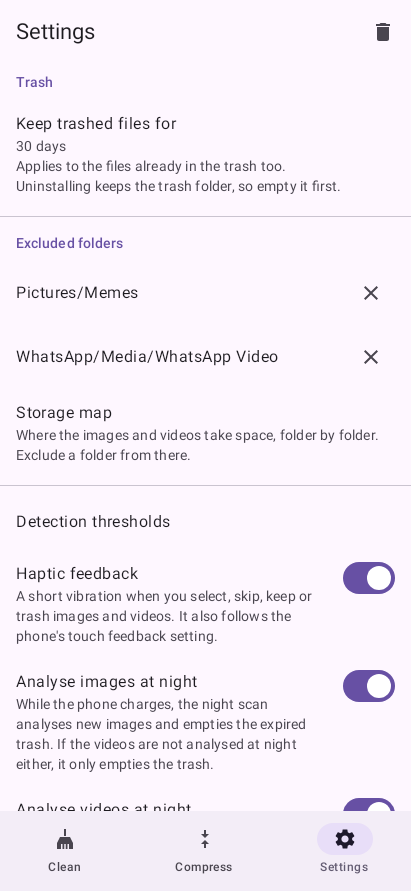</td>
    <td>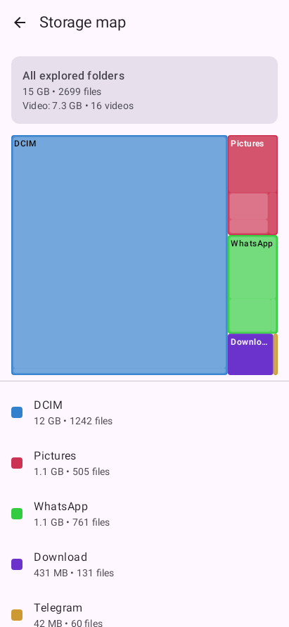</td>
  </tr>
</table>

The images in the screenshots are drawn in code, and the counts are made up.

## Technical architecture

Cribrum scans, runs its models and changes files on the device. The app has no network permission.

### Signals and ranking

Detectors emit `Signal` values with confidence scores, and the `Ranker` combines them into ordered candidate lists. A detector never decides on its own.

- **Recall over precision.** Showing a photo that turns out to be worth keeping is acceptable. Missing clutter is not.
- **Protections reorder without dropping.** Faces and gallery favourites lower an item in the review order and never remove it from the candidates.
- **No age signal.** The age of a photo or video is never a reason to delete it.

### On-device models

The app bundles three neural models and runs them with ONNX Runtime:

- **MobileCLIP2-S0.** A 45 MB image encoder that gives 512-dimensional embeddings for similar-copy search, zero-shot document and meme detection, and the five frames of each video. The text prompts are embedded in the Python lab and shipped as JSON, so the phone has no text encoder. The encoder runs on the GPU through WebGPU and falls back to the CPU.
- **YuNet.** A 230 KB face detector that protects portraits.
- **PP-OCRv4.** A text detector that measures how much of an image is text.

### Storage index and scan worker

- **Room database.** SQLite holds file metadata, hashes, embeddings (a video's frames too) and signals. A file is identified by path, size and modification time, so only new or changed files are analysed again.
- **Photo scan, five phases** ([`docs/design.md §4, §7`](docs/design.md)): the file walk, metadata, the detectors that read no embedding (`BLURRY`, `BAD_EXPOSURE`, `SCREENSHOT`, `FACES`, `STICKER` and the pHash), the embeddings with the detectors that read them (`DOCUMENT`, `FORWARDED`), and the group detectors (exact copies, similar copies, bursts).
- **Video scan, four phases.** The walk, the metadata, the five frames of each video (measured for blur, exposure and faces while they decode), and the group detectors that take videos.
- **WorkManager.** `IndexWorker` runs the night scan and the two scan buttons, one scan at a time.

### Python lab and parity

`lab/` is the Python reference implementation of the detectors and the ranking.

- **Mirrored components.** Modules in `cribrum_lab` mirror the Kotlin packages in `io.github.bert0ns.cribrum`, with the same names and types.
- **Golden fixtures.** `fixtures/` holds synthetic images and videos. The Python tests and the Android unit tests read them through their own decoders, to check that scores and rankings agree.
- **Parity check.** `python3 lab/scripts/check_parity.py` compares detector ids, versions, thresholds, protection weights and constants between Python and Kotlin.

## Build and verification

### Android app

Prerequisites: JDK 21 and the Android SDK.

```bash
cd android
./gradlew ktlintCheck testDebugUnitTest lintDebug assembleDebug :baselineprofile:compileNonMinifiedReleaseKotlin
```

To render the README and website screenshots:

```bash
./gradlew -PreadmeScreenshots testDebugUnitTest --tests '*ReadmeScreenshots'
```

### Python lab

Prerequisites: Python 3.12 and [uv](https://docs.astral.sh/uv/).

```bash
cd lab
uv run ruff check
uv run ruff format --check
uv run pytest
```

### Parity verification

From the repository root:

```bash
python3 lab/scripts/check_parity.py
```

[`AGENTS.md`](AGENTS.md) has the instructions for contributors (shared Gradle locking, JDK 21), and [`android/README.md`](android/README.md) covers installing a build on a phone.

## Status and requirements

- **Android version.** Android 11 (API 30) or newer, the first version with the scoped storage rules and `MANAGE_EXTERNAL_STORAGE` that Cribrum relies on.
- **Permissions.** "All files access" is required, to read folders outside MediaStore such as WhatsApp's `.nomedia` folders and to manage the trash. The manifest removes `android.permission.INTERNET`.
- **Distribution.** A sideloaded APK from the [GitHub releases page](https://github.com/Bert0ns/cribrum/releases). It is not on Google Play because of its storage access policy.

## Principles

- **Practical over pretty.** A clean, minimal UI whose features work.
- **Recall over precision.** Surface candidates for review. Missing clutter is worse than asking about a keeper.
- **Private by design.** Everything stays on the device, and the app cannot connect to a network.
- **Nothing is lost by accident.** A page of deletions has an Undo, a favourite asks first, a compression keeps its original in the trash, and deleting for good asks first.

## Repository layout

| Path | Contents |
|---|---|
| [`docs/design.md`](docs/design.md) | Design document: goals, decisions, architecture, roadmap |
| [`lab/`](lab/) | Python lab: reference implementation of detectors and labeling tools |
| [`android/`](android/) | Android app: Kotlin and Jetpack Compose |
| [`fixtures/`](fixtures/) | Golden test images and videos for parity verification |
| [`site/`](site/) | Website source files |
| [`docs/screenshots/`](docs/screenshots/) | Rendered application screenshots |

## Roadmap

The next steps are in [`docs/design.md`](docs/design.md#11-future-work-and-open-questions), section 11. The main ones are learning each category's threshold from your keep and trash decisions, and a single recall setting in place of one slider per category.

## License

Cribrum is free software, released under the [GNU General Public License v3.0](LICENSE).
